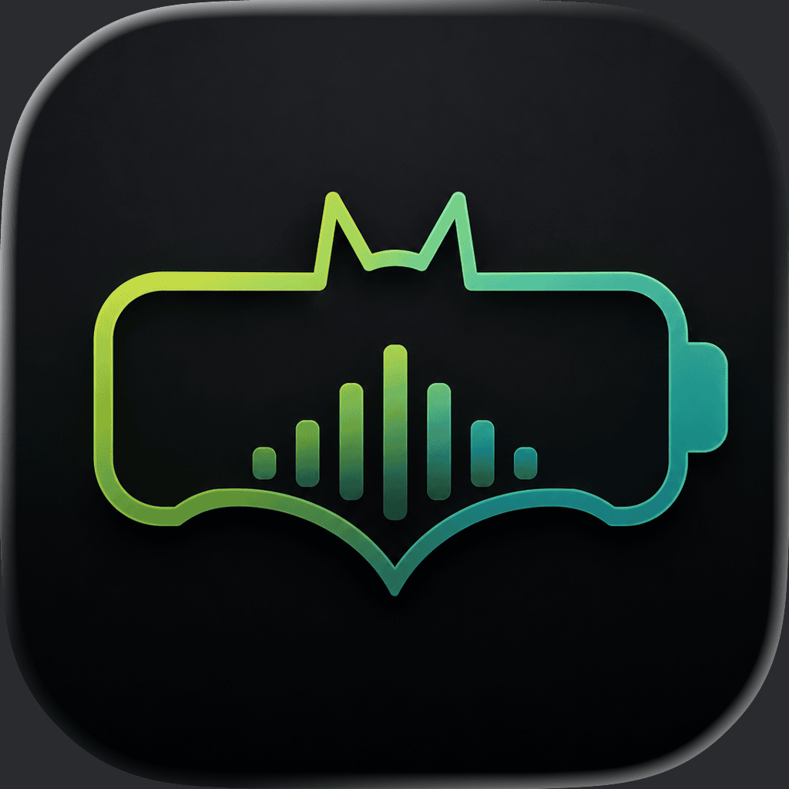
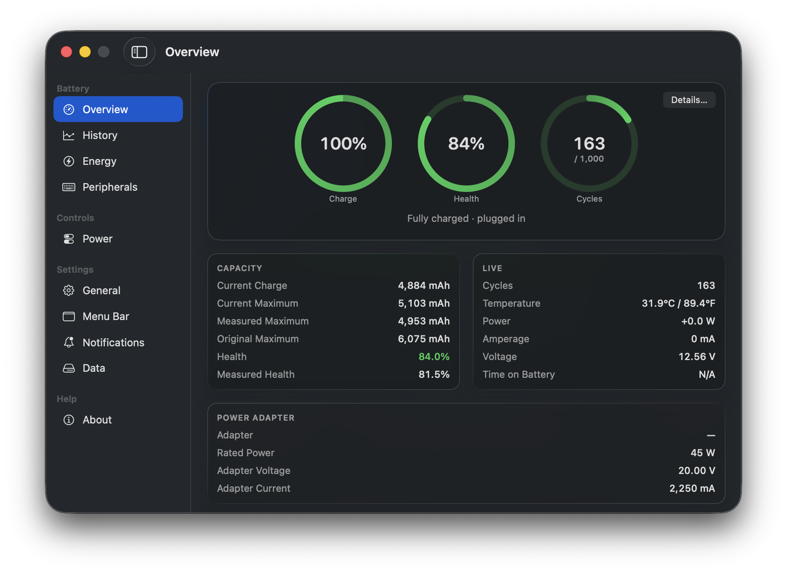
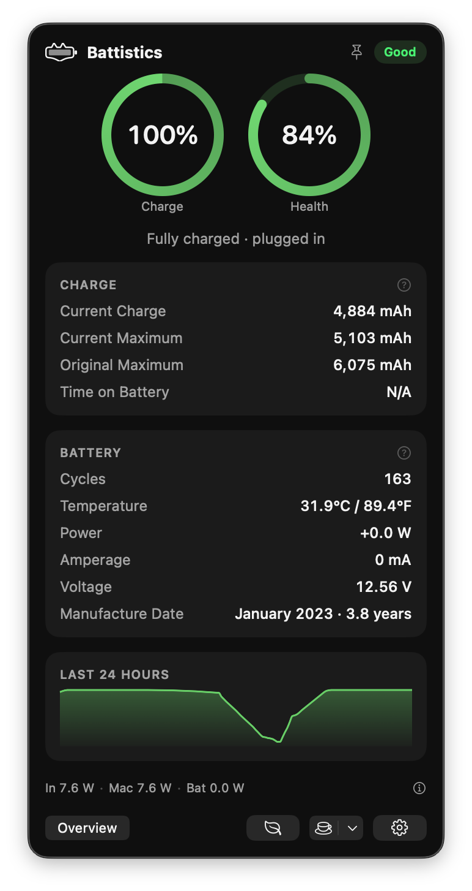
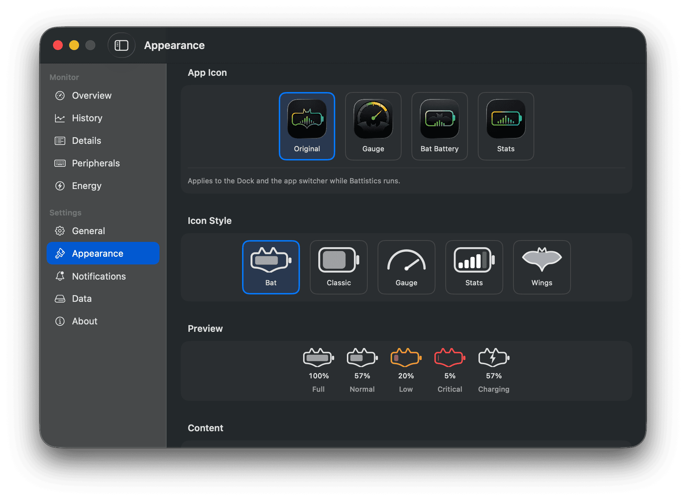

<p align="center">
  
</p>

<h1 align="center">Battistics</h1>

<p align="center">Battery statistics for the Mac. Free, open source, native.<br>
macOS 14+ · Apple Silicon</p>



<p align="center">
  
  
</p>

## Features

- Charge, health, capacity, cycles, temperature, power, voltage and time estimates at a glance
- History charts for charge, power, temperature and health across day, week, month and year
- Customizable menu bar icon: five styles, status colors, optional text, selectable app icon
- Notifications for low battery, full charge, charge limit, high temperature and health decline
- Battery levels of connected keyboards, mice, trackpads and headphones
- Energy view showing the busiest apps, sampled only while open
- Keep Awake for 15 minutes to 12 hours or until turned off, including with the lid closed
- Optional low-battery stop, advance warnings, and system thermal-pressure protection for Keep Awake
- A five-step first-run tour and searchable English/Turkish help
- Optional on-device Q&A using Apple Intelligence on supported Macs with macOS 26+
- Opt-in local MCP automation for named, bounded Keep Awake tasks owned by an AI client
- CSV export and import of the full history
- English and Turkish

## Keep Awake modes

| | Keep the display on | Let the display sleep | Stay awake with the lid closed |
|---|---|---|---|
| Display | Stays lit | Sleeps on its timer | Sleeps on its timer; the built-in one is off while shut |
| Closing the lid | Mac sleeps¹ | Mac sleeps¹ | Mac keeps running |
| Screen locks² | When you lock it or close the lid | When the display sleeps | When the display sleeps or the lid closes |
| Apple menu › Sleep | Works | Works | Ignored until the session ends |
| Battery use | Highest, the screen stays on | Low | Low, but a closed bag traps heat |
| Setup | None | None | Power helper, approved once in Login Items |
| Equivalent | `caffeinate -d` | `caffeinate -i` | `caffeinate -i` + `pmset disablesleep 1` |

All three work on battery or adapter and end on their timer even if Battistics is suspended. Closed-lid mode only borrows the system sleep setting: if Battistics quits or crashes the helper restores it within 45 seconds, a change made elsewhere is left alone, and a session that ends with the lid shut lets the Mac sleep.

¹ Unless it is in clamshell mode, with an external display and power connected.
² Only if Lock Screen settings require a password after the display turns off.

### Session protection

In **Power → Session Protection**, optionally end Keep Awake at 5–50% charge
(10% preselected; automatic stopping is **off by default**). This releases the
session and permits normal sleep; it never requests shutdown or closes apps.
The battery rule applies only on battery power. Low-charge warnings default to
20% and can be changed or disabled independently. When automatic stopping is
enabled, the warning level stays at least five percentage points above it.
Warnings appear in the app as well as through macOS notifications when allowed.

**Power → Thermal Care** reports the system thermal state and warns during a
session when macOS reports serious or critical pressure. An optional stop works
on either power source. Battistics does not change fan speeds; battery temperature is
not a CPU-temperature measurement.

Protection requires Battistics to be running and able to read system state.
A sudden charge drop can skip the warning. Ending closed-lid mode may allow
immediate sleep. Connect power for work that cannot be interrupted, and keep
vents clear; never put a running, closed Mac inside a bag.

### Tour and local help

The first dashboard visit opens a short tour; skip or replay it from **Help**.
**Help & Assistant** includes searchable answers on macOS 14+. On macOS 26+,
the optional assistant uses Apple's on-device Foundation Models when the model,
Apple Intelligence, and app language are available. AI selects a relevant guide
article and the app shows its reviewed text and source. It cannot change settings
and has no cloud fallback. Battistics does not save questions or answers. If the
selected article does not answer the question, the full guide is always available.

### Local MCP automation

In **Power → Local MCP automation**, enable access and copy the configuration
for your AI client. It can read status, start a named task for 15 minutes to
12 hours, and stop its own task when work finishes. Other clients and manual
sessions are left alone. Disconnects, deadlines, user stops, and enabled battery
or thermal protections end the task. Closed-lid tasks require a separate opt-in
and an already installed helper. No cloud service or network port is used.
See the [MCP setup and tool contract](docs/mcp.md).

Direct fan-speed overrides are not included in this version.
See [feature scope and verification](docs/session-protection.md).

## Light by design

Uses power-change notifications with a low-frequency battery refresh fallback. Detailed views and optional power-history recording add work while enabled. Background activity is minimized, but CPU and energy use vary with settings and hardware; no fixed 0.0% CPU guarantee is made.

## Install

```sh
brew install --cask doguyilmaz/tap/battistics
```

Or download the DMG from [Releases](https://github.com/doguyilmaz/battistics/releases) and drag Battistics to Applications.

Either way updates arrive in-app: Battistics updates itself, so Homebrew is told to leave it alone once installed.

## Build

```sh
brew install xcodegen
make run    # debug build and launch
make test   # unit tests
```

Run `make gen` and open `Battistics.xcodeproj` to work in Xcode.
The MCP dependency requires Swift 6.1 or later. After a debug build,
`python3 scripts/test-mcp-stdio.py` checks the bundled MCP server.

## Privacy

Runs entirely on your Mac. The only network request is the optional update check.

## License

MIT
