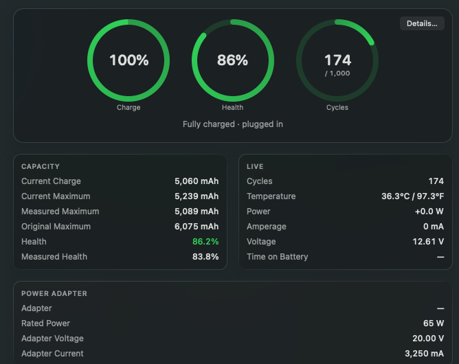

Battistics reads the battery from macOS when the power state changes, with a slow refresh in between. Nothing is estimated that macOS does not report; a value macOS has not reported shows a dash.

| Reading | What it means |
| --- | --- |
| Charge | The level macOS shows, in percent. |
| Health | What the battery holds when full today, against its design capacity. |
| Measured health | The same ratio from the full charge the battery measured most recently. It moves more from day to day. |
| Cycles | Full charges used so far, next to the number the battery was designed for. |
| Current charge | The charge in mAh right now. |
| Current maximum | What the battery holds when full today. |
| Original maximum | What it held when new. |
| Temperature | The battery's own sensor, in Celsius, Fahrenheit or both. |
| Power | Watts flowing into (positive) or out of (negative) the battery. |
| Amperage and voltage | The raw current and voltage behind the power figure. |
| Time on battery | How long since the Mac was last unplugged. |

## Power flow

The **Energy** pane shows what comes in from the adapter, what the Mac uses and what the battery adds or takes. The readings come from different sensors and can lag each other by a few seconds.

## Busiest apps

**Energy** also lists the apps using the most CPU, sampled only while the pane is open.
