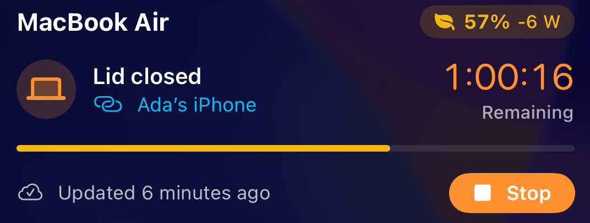

Battistics Remote shows the battery of each Mac on your Apple Account: charge and its last day, time left, power, health and temperature, the connection, the lid and the busiest apps and accessory batteries on request. It starts, extends and stops Keep Awake, including with the lid closed, and changes Low Power Mode.

:::tip[Coming soon to the App Store]
Battistics Remote is on its way. Set up your Mac today and it will be ready the moment the app lands on your iPhone.
:::

## Setting up

1. Install Battistics on the Mac.
2. In Battistics, open **iPhone** and turn on **Show this Mac in Battistics Remote**.
3. Sign in to iCloud on the iPhone and the Mac with the same Apple Account.

There is nothing to pair. The Mac and the iPhone talk through your private iCloud database, with readings and commands encrypted, no server and no open port. Closed-lid sessions from the iPhone are allowed only if you turn that on in the same pane.

## On the iPhone

- Home Screen and Lock Screen widgets that open the Mac they show, including one that lists every Mac; on the Home Screen it opens the one you tap
- A Lock Screen and Dynamic Island countdown with buttons to add 30 minutes or stop
- A Control Center and Action Button control
- Quick actions on the app icon to start, extend or stop Keep Awake
- Siri and Shortcuts: Keep Awake, Add Time, Let Sleep, Check Mac, Mac Low Power, Display Off and Open Mac, and Get Mac Battery Level for automations; each can name the Mac it acts on, and Check Mac hands its battery, charging and Keep Awake state to the next action
- A reminder five minutes before a session ends, with a button to add 30 minutes
- Alerts when a session ends, the Mac runs hot, the battery runs low, the Mac stops answering or reaches a charge level you pick. The Mac sends the first ones itself through your iCloud, so they arrive at once, even while the app is closed.

## No Mac yet?

On the first screen, **Try a Sample Mac** opens the app with made-up readings so you can try every control. Nothing is sent anywhere. **Show This iPhone's Battery** shows this iPhone's own battery, storage and network.

## Without Wi‑Fi

A Mac set to join your iPhone's Personal Hotspot automatically stays reachable from a bag. Battistics Remote reminds you before you close the lid on Wi‑Fi alone.

## Removing a Mac

If a Mac you erased or sold still shows, open its **Details** and choose **Remove Mac**. A Mac that is still sharing comes back with its next update.
