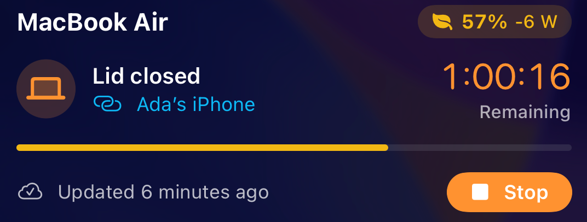

Battistics Remote shows the battery of each Mac on your Apple Account: charge and its last day, time left, power, health and temperature, the connection, the lid and the busiest apps and accessory batteries on request. It starts, extends and stops Keep Awake, including with the lid closed, and changes Low Power Mode.

Battistics Remote is [free on the App Store](https://apps.apple.com/app/id6827062128).

## Setting up

1. Install Battistics on the Mac.
2. In Battistics, open **iPhone** and turn on **Show this Mac in Battistics Remote**.
3. Sign in to iCloud on the iPhone and the Mac with the same Apple Account.
4. When asked, allow **Bluetooth** and **Local Network** on both devices for nearby connections.

There is no pairing code or additional account. Private iCloud establishes trust between your devices and carries encrypted readings and commands. Closed-lid sessions from the iPhone are allowed only if you turn that on in the same pane.

## Nearby connections in the next update

Updated versions of **both** apps add authenticated local-network and Bluetooth connections alongside iCloud. Earlier releases continue through iCloud.

- **Local Network:** reachable Wi-Fi or Ethernet, including a wired Mac and an iPhone on Wi-Fi. This path is used while Remote is foregrounded. Guest-network isolation or a firewall can prevent discovery.
- **Bluetooth:** nearby devices can connect even on different networks, such as a Mac on office Wi-Fi and an iPhone on cellular. Background delivery depends on iOS and the radio connection.
- **iCloud:** continues when devices are apart, with internet access on both. Initial trust setup also needs working iCloud and the same Apple Account.

Commands automatically try an available local connection, then Bluetooth, then iCloud. A retried command retains its identity so a lost reply does not add time twice. You do not select or pair transports manually. Turning sharing on advertises a local authenticated listener and Bluetooth service on the Mac; this is not a public internet relay.

## Permissions and recovery

On the Mac, open **iPhone › Nearby Connections** to check Bluetooth and open its privacy settings. If denied, allow Battistics in **System Settings › Privacy & Security › Bluetooth** and, on macOS 15 or later, **Local Network**. Bluetooth being off is separate from denying the app permission.

On the iPhone, open **Settings › Nearby Connections** in Remote, then **Open App Settings**. Allow Bluetooth and Local Network for Battistics Remote. Restricted access may require a device-management administrator. Return to the app after changing access; it refreshes the connection setup. A denied nearby permission does not disable iCloud sharing.

Location on the Mac is optional and used only to obtain the Wi-Fi/Hotspot name. It is not required for Bluetooth discovery. Battistics Remote does not request Location.

## Last update and the Lock Screen

The countdown advances using the system clock; that alone does not mean a new Mac reading arrived. The last-update time refers to the Mac's actual sample. The Mac sends connected nearby peers a status every 30 seconds, but that is not a phone background-delivery guarantee. iCloud silent pushes and background refresh can be delayed by iOS.

Live Activities can run for up to eight hours; this does not end Keep Awake on the Mac. Open Remote to reconcile an ongoing session and create a new activity when allowed. The app marks old data rather than inventing a fresh timestamp.

The **More Frequent Updates** option seen in some apps concerns frequent **ActivityKit push notifications**. Remote currently updates an activity after receiving data in the app, rather than through a dedicated ActivityKit push provider. Enabling that option alone would not increase CloudKit silent-push or Bluetooth delivery. See [Apple's explanation](https://developer.apple.com/documentation/BundleResources/Information-Property-List/NSSupportsLiveActivitiesFrequentUpdates).

## On the iPhone

- Home Screen and Lock Screen widgets that open the Mac they show, including one that lists every Mac; on the Home Screen it opens the one you tap
- A Lock Screen and Dynamic Island countdown with buttons to add 30 minutes or stop
- Control Center and Action Button controls to keep the Mac awake or turn off its display
- A charge chart you can drag across to read the charge at any hour
- Quick actions on the app icon to start, extend or stop Keep Awake
- Siri and Shortcuts: Keep Awake, Add Time, Let Sleep, Check Mac, Mac Low Power, Display Off and Open Mac, and Get Mac Battery Level for automations; each can name the Mac it acts on, and Check Mac says the time left and how long Keep Awake still runs, and hands its battery, charging and Keep Awake state to the next action
- A reminder five minutes before a session ends, with a button to add 30 minutes
- Alerts for unexpected session endings, heat, low battery, repeated missing updates or a chosen charge level. The Mac can send alerts through Apple push notifications while the app is closed; timing depends on the system and connection. Normal completion stays quiet.

## No Mac yet?

On the first screen, **Try a Sample Mac** opens the app with made-up readings so you can try every control. Nothing is sent anywhere. **Show This iPhone's Battery** shows this iPhone's own battery, storage and network.

## Without Wi‑Fi

A Mac set to join your iPhone's Personal Hotspot automatically can stay online while kept awake. Bluetooth adds a nearby path in the next update, but does not provide internet to the Mac. Check ventilation and Session Protection before putting an awake Mac in a bag.

## Removing a Mac

If a Mac you erased or sold still shows, open its **Details** and choose **Remove Mac**. A Mac that is still sharing comes back with its next update.

To revoke nearby access, turn sharing off **on the Mac**. That closes its listeners/connections and discards the local credential; the next enable creates a new key. Removing a Mac on one phone is not a permanent block or per-phone revocation. CloudKit record cleanup is retried when connectivity returns.
