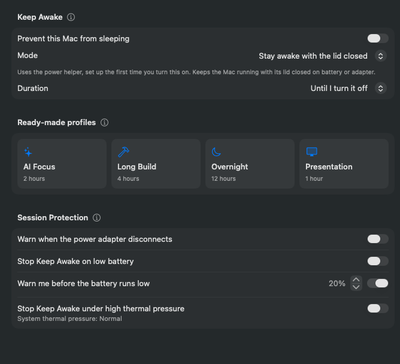

Start Keep Awake from the popover, the **Keep Awake** pane, a profile, the terminal, an AI client or your iPhone. Pick a duration from 15 minutes to 12 hours, or until you turn it off. Changing the duration during a session applies it from that moment; **Add Time** on the running session adds 15 minutes to 2 hours to what is left.

| | Display on | Display may sleep | Lid closed |
| --- | --- | --- | --- |
| Display | Stays lit | Sleeps on its timer | Sleeps on its timer; the built-in one is off while shut |
| Closing the lid | Mac sleeps¹ | Mac sleeps¹ | Mac keeps running |
| Screen locks² | When you lock it or close the lid | When the display sleeps | When the display sleeps or the lid closes |
| Apple menu › Sleep | Works | Works | Ignored until the session ends |
| Battery use | Highest | Low | Low, but a closed bag traps heat |
| Setup | None | None | [Power helper](/docs/keep-awake/closed-lid/), approved once |
| Same as | `caffeinate -d` | `caffeinate -i` | `caffeinate -i` + `pmset disablesleep 1` |

¹ Unless the Mac is in clamshell mode with an external display and power connected.

² Only if Lock Screen settings ask for a password after the display turns off.

All three work on battery or adapter and end on their timer even if Battistics is suspended.

If the Mac sleeps, shuts down or restarts during a session anyway, Keep Awake ends and does not start again when the Mac wakes.

## Profiles

| Profile | Duration | Display |
| --- | --- | --- |
| AI Focus | 2 hours | May sleep |
| Long Build | 4 hours | May sleep |
| Overnight | 12 hours | May sleep |
| Presentation | 1 hour | Stays on |

Profiles start a timed session, change no settings and never use closed-lid mode. They do not replace a session that is already running.
